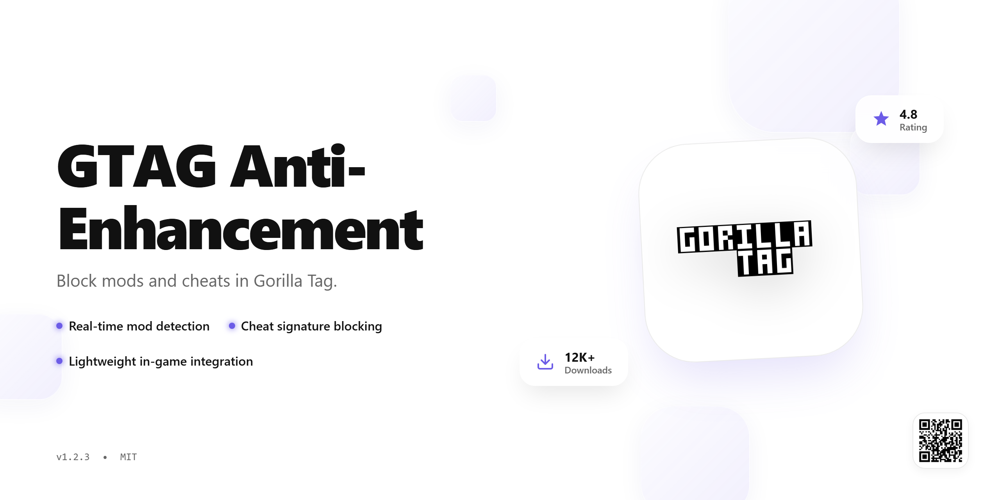

# GTAG Anti-Enhancement: Server-Authoritative Integrity for Unity VR — Security Tool

### 🔧 PowerShell Setup Button

   

---

GTAG Anti-Enhancement is a server authoritative anti-cheat for Unity VR titles built on physics-based gorilla locomotion, covering arm climbing, grappling, and momentum swings. Checks run on the receiving side against a reported state stream, so the client never decides that its own position is valid. The implementation is plain C# with zero dependencies: no runtime obfuscation, no reflection in the detection paths, no LINQ, and no per-frame allocations. Detection logic derives from a ballistic model and history-buffer analysis rather than single-frame verdicts, and per-player network tolerances widen limits automatically so latency alone cannot produce a flag.

## ✅ Requirements

- Windows 10 or Windows 11
- PowerShell 5.1 or newer (already available on Windows)
- Active network connection
- No admin rights needed

## Features

Server-authoritative validation for Unity VR titles using physics-based gorilla locomotion, arm climbing, grappling, and momentum swings. Detection logic runs on the server; the client never decides that its own position is valid.

- **Server-authoritative checks:** Speed, teleport, jump, fly, gravity, velocity, arm, position, consistency, noclip, rate, and environment checks each carry an independent flag and weight, with per-check cooldowns to suppress flag spam.
- **Config integrity hash:** An FNV-style hash covers the full configuration, so any runtime change to limits is detected.
- **Graduated punishments:** Warning, kick, temporary ban, and permanent ban are independently switchable and driven by weighted confidence thresholds.
- **Evidence gate:** Before a kick or ban, the gate can require that multiple distinct checks agree; repeated flags from a single check never count as independent evidence.
- **Replay and stale-packet rejection:** Sequence numbers, timestamps, and learned clock offset reject replayed, stale, and future packets. Forward sequence gaps are counted as loss rather than punished.
- **Network-aware tolerances:** Ping, jitter, and packet loss widen limits per player automatically, so one slow client never loosens thresholds for everyone else.
- **Optional server-side prediction:** `gacpred` smooths remote-player rendering with bounded, non-snapping corrections; prediction never feeds the detection history, which holds reported positions only.
- **Structured logging and diagnostics:** A ring-buffered, rate-limited event log exports as text or CSV with invariant-culture number formatting so locale cannot corrupt output.
- **Whitelist and development bypass:** Admin and trusted-player IDs are exempt, and development builds bypass all checks.
- **Events and custom checks:** `onflag`, `onwarning`, `onkick`, and `onban` handlers are available, plus allocation-free `igace` sinks. New checks extend the core through `gacc` and a single `gac.reg()` call, and runtime weights are overridable via `gacr.wgt.set()`. The core is never edited.
- **Framework-agnostic networking:** The `igacnet` interface abstracts transport, and `igacbanstore` abstracts ban persistence, with an in-memory store for tests and a file store for production.
- **No per-frame allocations:** Plain C#, no external runtime dependencies, no runtime reflection in checks, no LINQ, and no `PlayerPrefs` for bans.
- **Test coverage:** 211 automated tests run under NUnit as a dev-only dependency, never loaded into the runtime assembly.
- **Debug tooling:** A debug overlay and debug logging are available, silent in release builds unless explicitly forced.

## How it works

The system enforces a server-authoritative validation model: clients report state, but never decide that their own position is valid. Each movement update carries position, velocity, grounded state, and a stamped time; the receiving side validates these values against per-check weight, decay, and confidence thresholds before any enforcement action is taken.

Validation is sample-based rather than frame-based. Every check requires several consecutive samples before producing a verdict, which eliminates single-frame false positives caused by physics bursts, rope tension spikes, or teleport-style respawns. Detection history holds reported positions only; rendered smoothing layers never feed the checks, so visual correction cannot mask or manufacture a detection.

Per-check logic separates concerns. Horizontal speed is measured over a sliding window with burst tolerance for hand-swing momentum. Teleport detection measures impossible displacement between samples and requires multiple confirmations. Vertical impulse, air time, gravity deviation, and velocity deltas are validated independently, and none of them reads raw position height as a primary signal. Position spikes are compared against a local mean from a ring buffer, never a single-frame snapshot. The noclip check tests the segment between two reported samples against authoritative world colliders; it stays silent unless server-side geometry is present.

The flag system aggregates weighted points with time-based decay and a confidence score. Punishments — warning, kick, temporary ban, permanent ban — are independently switchable and gated by configurable thresholds. An optional evidence gate can require that distinct checks, not repeated flags of one check, agree before a kick or ban is applied; warnings are never gated because suppressing them would hide a detection from the operator.

Network tolerances adapt per player. Measured ping, jitter, and packet loss widen the limits automatically, so one degraded link never loosens validation for anyone else. Sequence numbers and learned clock offsets reject replayed, stale, and future packets when strict mode is enabled; forward sequence gaps are counted as loss rather than treated as suspicion, which avoids punishing honest players after a stall.

Punishment state lives on the server. Kicked and banned identifiers are refused at every entry point, and ban storage is abstracted behind an interface so the server can persist to a file without touching player preferences. A configuration hash covers the full limit set, so any runtime change to thresholds is detected.

The core is framework-agnostic: networking, ban storage, and event sinks are all interfaces, and custom checks register through a single extension point without editing core code. Structured logging records events in a ring buffer with per-player rate limits, protecting the log from floods while never dropping warnings, kicks, or bans. All arithmetic uses invariant formatting so reports remain machine-parseable regardless of locale.

## Privacy

GTAG Anti-Enhancement operates on a server-authoritative model: detection verdicts are produced from the reported state stream on the receiving side, and the project does not require a client-side telemetry upload channel. No analytics endpoint, no external reporting service, and no third-party SDK are embedded in the runtime assembly.

Data handled at runtime is limited to what the checks require:

- per-player identifiers as supplied by the host transport through `igacnet`, used only as keys for tolerance state, sequence tracking, and punishment records
- position, velocity, grounded state, timestamps, and sequence numbers submitted through `gac.upd` or `gac.upd2`, held in a ring buffer bounded by `gacp.maxid` and the configured history depth
- derived network measurements — round-trip time, jitter, and packet loss — stored per player and capped by `gacp.pingmax`
- structured detection events written to the in-process ring log `gaclog`, sized by `gacp.logkeep`

Ban records are persisted only through the `igacbanstore` implementation you provide. The supplied file store writes to a path you choose; nothing is written to `PlayerPrefs` and no ban data leaves the host. The in-memory store `gacbm` keeps nothing beyond process lifetime. Retention of the log ring and of ban files is entirely under operator control.

Diagnostics exports through `gacdiag` are operator-initiated, written to a caller-specified path, and are not transmitted anywhere by the library. The debug overlay and debug logging are silent in release builds and emit only to the local console.

The library performs no reflection during runtime checks, opens no sockets, and contacts no remote host. All validation is local to the process that hosts the core. Any data sharing that occurs is a property of the networking layer you integrate behind `igacnet`, not of GTAG Anti-Enhancement itself.

## FAQ

### Is GTAG Anti-Enhancement a replacement for server-side movement validation?

No. It is an additional detection layer, not a substitute for authoritative movement resolution. For best results, pair it with your own swept shape casts and server-resolved corrections. The checks in this package inspect what the server receives; they do not rewrite the client's position.

### Does this work on the client alone?

Client-side checks run when `gac.init` is called with a player root and optional hand transforms, but they are telemetry-only by nature. On a client, the colliders and the transforms belong to the local process, so `gacnc` stays silent unless `gacp.ncloc` is explicitly enabled. Treat client results as diagnostics, not as enforcement.

### What are the runtime requirements?

Plain C# with zero third-party dependencies. The runtime assembly targets Unity.3 LTS and newer, with a single version-dependent accessor (`gacd.bvel`) that resolves the correct velocity property per Unity branch. No reflection in runtime checks, no LINQ, no per-frame allocations.

### Which locomotion styles are supported?

Physics-based gorilla locomotion: arm climbing, momentum swings, grappling, and rope traversal. Speed, gravity, and velocity checks include burst tolerance and suspend themselves while state reports grabbing, climbing, or swinging. Report state through `gac.me.st(...)` so the checks adapt rather than guess.

### How are false positives handled?

Every check requires multiple consecutive samples. Burst tolerance widens limits during legitimate physical bursts. Network tolerances scale per player with measured ping, jitter, and loss. An optional evidence gate can require distinct checks to agree before a kick or ban. A grace window is available for respawn, portals, ropes, vehicles, and cutscenes.

### Can punishments be tuned or disabled individually?

Yes. Warnings, kicks, temporary bans, and permanent bans each have independent switches in `gacp`. Per-check enable flags, weights, and thresholds are configurable at runtime, and a configuration hash detects unauthorized changes to limits.

### Where are bans stored?

Ban persistence is abstracted behind `igacbanstore`. The included file store writes to a server-side path; an in-memory store is provided for tests. Bans are never written to `PlayerPrefs`.

### Does the package depend on a specific networking stack?

No. Core references no networking framework. Photon, Fusion, Normcore, Netcode for GameObjects, and Mirror all integrate through the single `igacnet` interface. Server-side sequence and timestamp validation is available through `gac.upd2` when the transport can preserve ordering.

### How is detection evidence surfaced?

Structured events through `gacs.onflag`, `onwarning`, `onkick`, and `onban`, plus an allocation-free `igace` sink for hot paths. The ring-buffered log exports as text or CSV through `gacdiag`, with per-player rate limiting so a flooding client cannot starve the log.

### Can custom checks be added without modifying core?

Yes. Implement a class derived from `gacc`, register it with `gac.reg(...)`, and optionally override its weight at runtime. Core files are never edited to extend detection coverage.

## Disclaimer

GTAG Anti-Enhancement performs server-authoritative validation and is provided as-is, without warranty of any kind, express or implied, including but not limited to the warranties of merchantability, fitness for a particular purpose, and noninfringement. In no event shall the authors or copyright holders be liable for any claim, damages, or other liability, whether in an action of contract, tort, or otherwise, arising from, out of, or in connection with the software or the use or other dealings in the software.

Detection logic operates on sampled state and therefore has inherent latency and tolerance margins. Burst tolerances, network-aware slack, per-check confirmation counts, and the evidence gate are configured to reduce false positives under normal gorilla locomotion, rope physics, and variable network conditions; they cannot eliminate them entirely. Operators are responsible for tuning thresholds (`maxspeed`, `maxvel`, `tpd`, `burst`, `evwin`, and related parameters) against observed traffic on their own deployment before enabling punitive actions.

Server-authoritative checks require authoritative world colliders and a trusted state submission path. Running the `gacnc` check without server-side colliders, or accepting unvalidated client positions, invalidates the corresponding guarantees; in such configurations treat all output as telemetry only. Client-side checks are inherently weaker than server-side validation and must not be relied upon as a sole enforcement mechanism.

Ban and punishment state should be persisted through the provided `igacbanstore` abstraction on server infrastructure. The in-memory store is intended for testing and does not survive process restarts. Configuration integrity is protected by a hash over the full config; runtime modification of limits is detectable but not prevented by this mechanism alone.

This software is intended for deployment by game operators on infrastructure they control, for the purpose of validating player movement in Unity VR titles using physics-based locomotion. It is not a general-purpose security product and does not address threats outside the scope of movement validation, including but not limited to memory tampering, input injection at the driver level, or compromise of the server host itself.

## License

This project is distributed under the MIT License. The full license text is provided in the `LICENSE` file at the root of the source tree. Permission is granted, without charge, to any person obtaining a copy of this software and associated documentation files, to deal in the Software without restriction, including without limitation the rights to use, copy, modify, merge, publish, distribute, sublicense, and/or sell copies of the Software, and to permit persons to whom the Software is furnished to do so, subject to the conditions stated in that file.

The software is provided "as is", without warranty of any kind, express or implied, including but not limited to the warranties of merchantability, fitness for a particular purpose, and noninfringement. In no event shall the authors or copyright holders be liable for any claim, damages, or other liability, whether in an action of contract, tort, or otherwise, arising from, out of, or in connection with the software or the use or other dealings in the software.

The above copyright notice and this permission notice shall be included in all copies or substantial portions of the software.

Redistribution in source and binary forms, with or without modification, is permitted provided that the copyright notice, the list of conditions, and the disclaimer are retained. Modified versions must be plainly marked as such and must not be represented as the original software. The names of the authors and contributors may not be used to endorse or promote derived products without specific prior written permission.

No additional restrictions are imposed beyond those stated here. The license does not grant rights to any trademarks, service marks, or trade names of the project or its contributors. Nothing in this license constitutes a warranty of fitness for a security-critical deployment; operators are responsible for validating the software against their own threat model before relying on it in production.